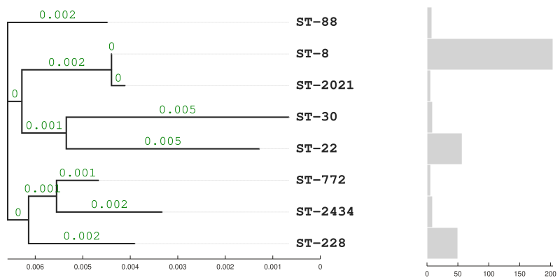

# Potoki obliczeniowe w bioinformatyce

**Anastasiya Pautarak i Zofia Sikorska**

Projekt realizuje zadanie POwB_05, dotyczące zautomatyzowanego typowania MLST (*multilocus sequence typing*) genomów *Staphylococcus aureus* oraz przedstawienia pokrewieństwa między wykrytymi typami sekwencyjnymi (ST).

## Cel zadania

Celem jest dokończenie potoku Snakemake: od wyszukania fragmentów siedmiu genów MLST w złożeniach genomów, przez identyfikację alleli i przypisanie ST, po utworzenie drzewa metodą *neighbour joining*, NJ. Analizowane loci to `arcC`, `aroE`, `glpF`, `gmk`, `pta`, `tpi` i `yqiL`.

Numery alleli oraz odpowiadające im ST są ustalane na podstawie lokalnych plików bazy PubMLST: `input/alleles.fna` i `input/bigsdb.tsv`. Połączone sekwencje loci o jednakowych długościach służą jako dopasowanie do obliczenia drzewa, bez osobnego etapu dopasowania wielosekwencyjnego.

## Etapy potoku

| Reguła | Działanie | Wynik |
| --- | --- | --- |
| `blastn` | Wyszukiwanie każdego z siedmiu loci w każdym genomie; próg E-value: `0.01`. | `output/blastn/blastn_{asmid}_{seqid}.tsv` |
| `filter` | Zachowanie trafień o pokryciu zapytania 100% i długości dopasowania równej długości zapytania. | `output/filter/filtered_{asmid}_{seqid}.tsv` |
| `merge_flt` | Łączenie trafień wszystkich loci dla pojedynczego genomu. | `output/merge_flt/merged_{asmid}.tsv` |
| `mlst` | Identyfikacja alleli i przypisanie ST; połączenie sekwencji w kolejności alfabetycznej nazw genów. | `output/mlst/mlst_{asmid}.tsv` |
| `merge_mlst` | Zebranie wyników wszystkich genomów w jednej tabeli. | `output/merged.tsv` |
| `unique` | Pominięcie ST nieoznaczonych i zapis unikalnych połączonych sekwencji. | `output/unique.fna` |
| `tree` | Obliczenie drzewa NJ z odległości opartych na identyczności sekwencji oraz wizualizacja z liczebnościami ST. | `output/tree.newick`, `output/tree.png` |

Tabela MLST zawiera kolumny `asmid` (identyfikator genomu), `ST` i `mergedseq` (połączone sekwencje loci). Wartość `ST = -1` oznacza brak jednoznacznego przypisania: nie uzyskano dokładnie siedmiu różnych loci, wykryto allel nieobecny w bazie lub nie znaleziono dokładnie jednego pasującego profilu ST. Takie rekordy są pomijane przy budowie drzewa.

## Zawartość folderu

```text
.
├── Snakefile                         # reguły i zależności potoku
├── envs/                             # definicje środowisk Conda
├── scripts/                          # filter.py, mlst.py, unique.py, tree.py
├── input/
│   ├── queries/                      # siedem zapytań FASTA (allele nr 1)
│   ├── alleles.fna                   # sekwencje referencyjnych alleli
│   └── bigsdb.tsv                    # profile alleliczne i numery ST
├── genomes_test/                     # 10 genomów testowych z zadania
├── genomes_all/                      # 100 genomów docelowych z zadania
├── Gordon_et_al_2017_raw_assemblies/ # 349 genomów, aktualnie wybrany zbiór
├── output/                           # wyniki pośrednie i końcowe
└── log/                              # logi poszczególnych etapów
```

Pliki genomów mają format skompresowanego FASTA i rozszerzenie `.fna.gz`. Nazwa pliku bez tego rozszerzenia jest identyfikatorem `asmid`.

## Uruchomienie

Wymagane są Conda oraz powłoka Bash dostępna dla reguł potoku. Polecenia należy wykonywać w głównym katalogu projektu.

1. Utwórz i aktywuj środowisko Snakemake:

   ```bash
   conda env create -f envs/powb-snake.yml
   conda activate powb-snake
   ```

2. Wybierz zbiór genomów w `config.yml`. Aktualna konfiguracja to:

   ```yaml
   genomesdir: Gordon_et_al_2017_raw_assemblies
   ```

   Aby odtworzyć analizę zbiorów wskazanych w zadaniu, ustaw odpowiednio `genomes_test` albo `genomes_all`.

3. Sprawdź plan wykonania i uruchom analizę (!liczba **rdzeni** załezy od sprzętu!):

   ```bash
   snakemake --use-conda --cores 4
   snakemake --use-conda --cores 4
   ```

   Liczbę rdzeni można dostosować do komputera. Snakemake przygotuje środowiska wskazane w regułach na podstawie plików `envs/powb-blast.yml` i `envs/powb-python.yml`. Pierwsze uruchomienie wymaga dostępu do kanałów Conda. Konkretne wersje zależności zapisano w plikach środowisk.

Domyślna reguła `all` wymaga obu plików końcowych: `output/tree.newick` oraz `output/tree.png`, więc uruchomienie obejmuje cały potok. Analizy różnych zbiorów należy wykonywać w osobnych kopiach projektu z pustymi katalogami `output/` i `log/`. Reguły łączenia korzystają z masek plików, dlatego pozostawienie wyników wcześniejszego zbioru mogłoby włączyć je do nowej analizy.

Pomoc dla poszczególnych skryptów jest dostępna przez opcję `--help`, np. w środowisku z zależnościami Python:

```bash
python scripts/mlst.py --help
```

## Wyniki zapisane w projekcie

Obecny plik `output/merged.tsv` zawiera wyniki dla **349 genomów** ze zbioru `Gordon_et_al_2017_raw_assemblies`. Wszystkim przypisano ST; uzyskano **8 typów sekwencyjnych** i 8 sekwencji w `output/unique.fna`.

| Typ sekwencyjny | Liczba genomów |
| --- | ---: |
| ST-8 | 204 |
| ST-22 | 57 |
| ST-30 | 9 |
| ST-88 | 8 |
| ST-228 | 50 |
| ST-772 | 6 |
| ST-2021 | 6 |
| ST-2434 | 9 |
| **Razem** | **349** |

Drzewo w formacie tekstowym znajduje się w [output/tree.newick](output/tree.newick), a jego wizualizacja wraz z wykresem liczby genomów przypisanych do poszczególnych ST — w [output/tree.png](output/tree.png). Wyniki te dotyczą aktualnego zbioru 349 genomów.



## Porównanie z wynikami Gordon i wsp. (2017)

Na uzyskanym drzewie widocznych jest 8 z 11 typów sekwencyjnych *Staphylococcus aureus* opisanych w tabeli 1 Gordon i wsp. (2017), a wspólne grupowanie ST8 i ST2021 jest zgodne z przypisaniem obu typów do kompleksu klonalnego CC8.

Na uzyskanym drzewie ST8 i ST2021 tworzą parę połączoną wspólnym węzłem. W publikacji oba typy należą do tego samego kompleksu klonalnego CC8 i mają ten sam typ spa t008. Grupowanie na drzewie jest więc zgodne z klasyfikacją autorów. Te typy występowały jednak w różnych ogniskach. ST8 opisano w ogniskach D i G, a ST2021 w ognisku B. Trzeci typ zaliczony przez autorów do CC8, ST239, występował w ognisku C i nie jest widoczny na uzyskanym drzewie.

ST8 odpowiadał za największą liczbę przypadków w publikacji. Aż 187 z 204 przypadków przypisanych do ST8 pochodziło z jednego ogniska, G. Z kolei ST30 wystąpił w największej liczbie ognisk, bo aż w sześciu, ale łącznie obejmował 35 przypadków. Pokazuje to, że typ najczęstszy wśród przypadków może występować w mniejszej liczbie ognisk.

Po prawej stronie uzyskanego drzewa najdłuższe słupki mają kolejno ST8, ST22 i ST228. Jeśli słupki przedstawiają liczby izolatów, kolejność tych trzech typów jest zgodna z tabelą 1. Porównanie dokładnych liczebności wymaga sprawdzenia wartości użytych do narysowania słupków i dopasowania identyfikatorów izolatów.
